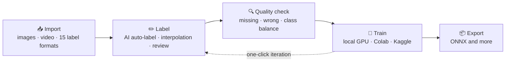
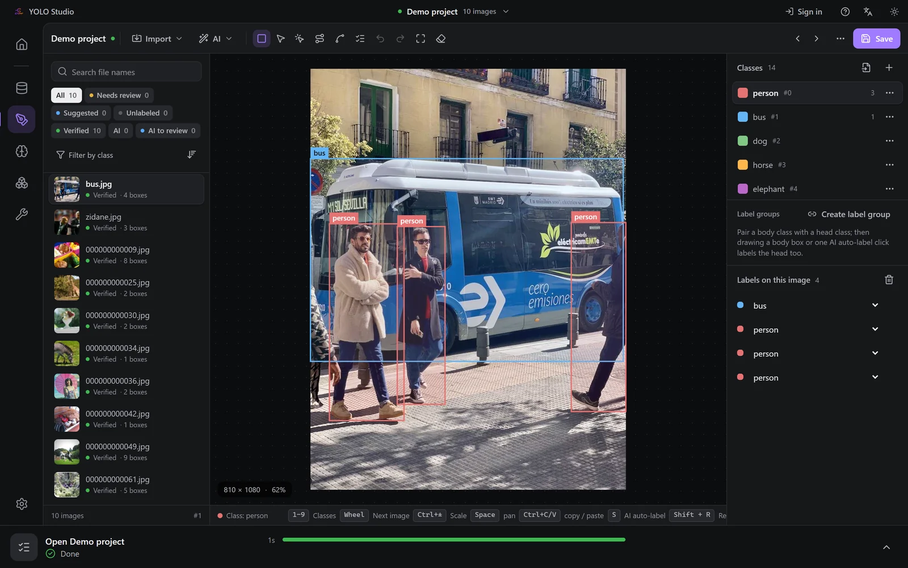
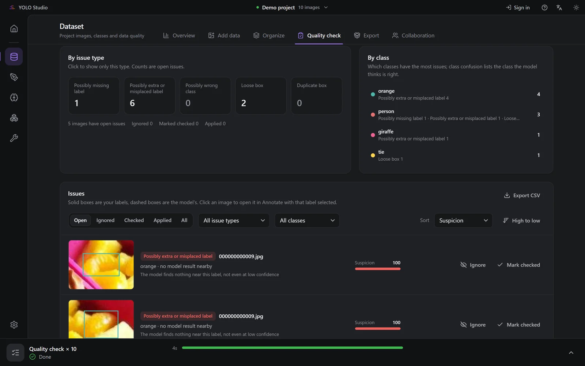
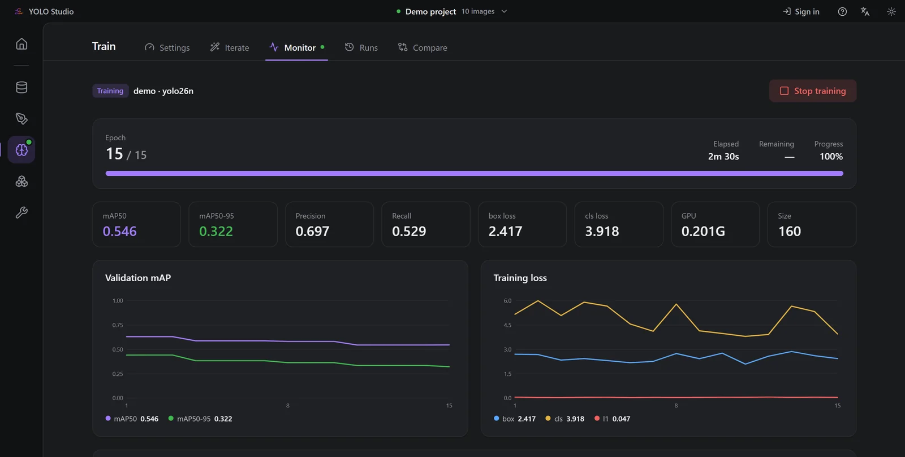
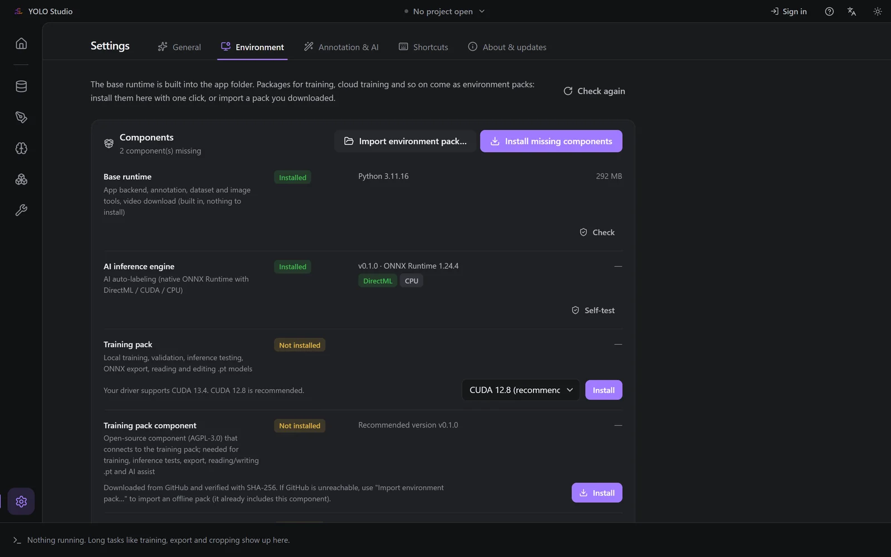

# CVM YOLO Studio

**Data, labeling, training and export — the whole YOLO workflow in one desktop app.**

[繁體中文](README.md) · English

> [!NOTE]
> This repository is the **training-pack component of CVM YOLO Studio** (open source, AGPL-3.0). Regular users
> **don't** need to download it: in the app, open **Settings → Environment** and press **Install** — the matching
> version is downloaded and verified automatically. See [About this repository](#about-this-repository).

---

## Why CVM YOLO Studio

Training a useful YOLO model usually means juggling a labeling tool, conversion scripts, training commands and
export tools. CVM YOLO Studio turns that into one flow — unzip, run, and go.

## Highlights

### ✏️ Labeling

| | |
| --- | --- |
| **AI auto-label** | Click an object to label it, with high / medium / low precision — or **import your own ONNX / PyTorch model** and map its classes automatically |
| **Head + body groups** | Label a body and its head is added too, even in crowds; boxes or outlines |
| **Keyframe interpolation** | Label two frames and every frame in between gets a box — great for game footage |
| **Tracking propagation** | Pick objects once and follow them through the next frames; preview before applying |
| **Text-prompt labeling** | Describe an object in English to find it, no training needed |
| **Learn from my labels** | Use the images you already labeled as examples to improve AI auto-label right away, or let it learn in the background as you label |
| **Low-confidence review** | Check the least certain AI results first with `Shift+R` |
| **Tasks** | Detection, segmentation, pose, oriented boxes |

### 🗂️ Data

- **15 label formats** — YOLO, COCO, Pascal VOC, LabelMe and more; **open existing datasets in place and write back**
- **Quality check** — compare a model with your labels and rank likely missing, extra, wrong-class, loose and duplicate boxes
- **Class balance** — per-class counts, imbalance ratio, and roughly how many more images each class needs
- **Dataset tools** — duplicate detection, ROI cropping, video frame extraction, splits, augmentation

### 🧠 Training & models

- **Local GPU, Google Colab or Kaggle**, with live loss / mAP curves
- **One-click iteration (active learning)** — train → auto-label the rest → review → next round
- **Model registry** — dataset fingerprint, parameters and metrics for every run; compare and tag production versions
- **Auto-tune** — search learning rate, augmentation and more with short runs; apply the best in one click
- **Export** — ONNX and other deployment formats, with a built-in native inference engine for checks and batch runs

### 👥 Collaboration preview

- Several people label one project on a LAN: per-image locks, live sync, revision history, review flow
- Whitelist + share links, encrypted connections with identity checks
- Official server, self-hosted server and remote direct connections are coming

### Interface

- **Portable** — unzip and run one exe; install the training environment from the Environment page
- **Detects your setup** — reuses installed CUDA, cuDNN and PyTorch; picks mainland-China mirrors when faster
- **Large projects** — a project with tens of thousands of images opens in about 2 s and saves in about 0.3 s
- Traditional Chinese / Simplified Chinese / English, dark and light themes, guided tour, one-click diagnostics

## Screenshots

<table>
  <tr>
    <td colspan="2" align="center">
       
      <b>Labeling</b>: full-screen editor with class and label lists
    </td>
  </tr>
  <tr>
    <td width="50%" align="center">
       
      <b>Quality check</b>: likely missing, extra and loose boxes, ranked
    </td>
    <td width="50%" align="center">
       
      <b>Training</b>: live mAP / loss curves
    </td>
  </tr>
  <tr>
    <td colspan="2" align="center">
       
      <b>Environment</b>: install the training pack and this component in one click
    </td>
  </tr>
</table>

Screenshots use a demo project (Ultralytics sample images and the coco8 dataset); the interface is shown in Traditional Chinese.

## Download

**Preview — public downloads are coming soon.**

| Plan | Includes |
| --- | --- |
| **Free** | All labeling, data, training and export features, plus advanced training parameters, run comparison, auto-tune and joining collaboration |
| **Pro** | Create shared projects and use the official collaboration server |

A free account and an internet connection are required (you can keep working through a short outage of up to 30 minutes).

### System requirements

- Windows 10 / 11 (64-bit)
- An NVIDIA GPU is recommended for training; without one you can still label and run inference on the GPU (DirectML) or CPU
- 16 GB RAM recommended

## About this repository

This is CVM YOLO Studio's **training-pack component**. It hands the app's training, validation, inference and
export requests to [Ultralytics](https://github.com/ultralytics/ultralytics) and returns the results.

- **Installed automatically** — the app downloads the version it is paired with from Settings → Environment and verifies its sha256.
- **Paired versions** — the component and the app are released together; the internal protocol changes with the app and isn't documented for standalone use.
- **Release assets** — each [Release](../../releases) has `ul_bridge-<version>.zip` and its `.sha256`.

## License

- **This repository**: [GNU AGPL-3.0](LICENSE).
- **The CVM YOLO Studio app**: proprietary, free to use. The app doesn't bundle Ultralytics; training features run in a separate process through this component.
- **Third-party components**: see [THIRD_PARTY_NOTICES.md](THIRD_PARTY_NOTICES.md). Ultralytics is AGPL-3.0.

CVM YOLO Studio · Made for people who just want to train a good model.

