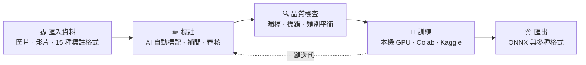
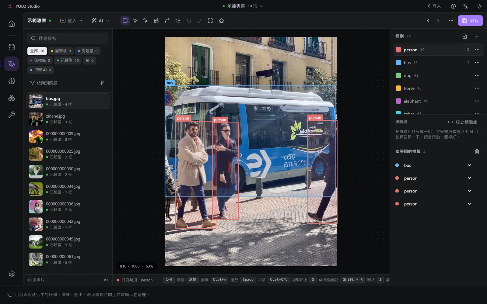
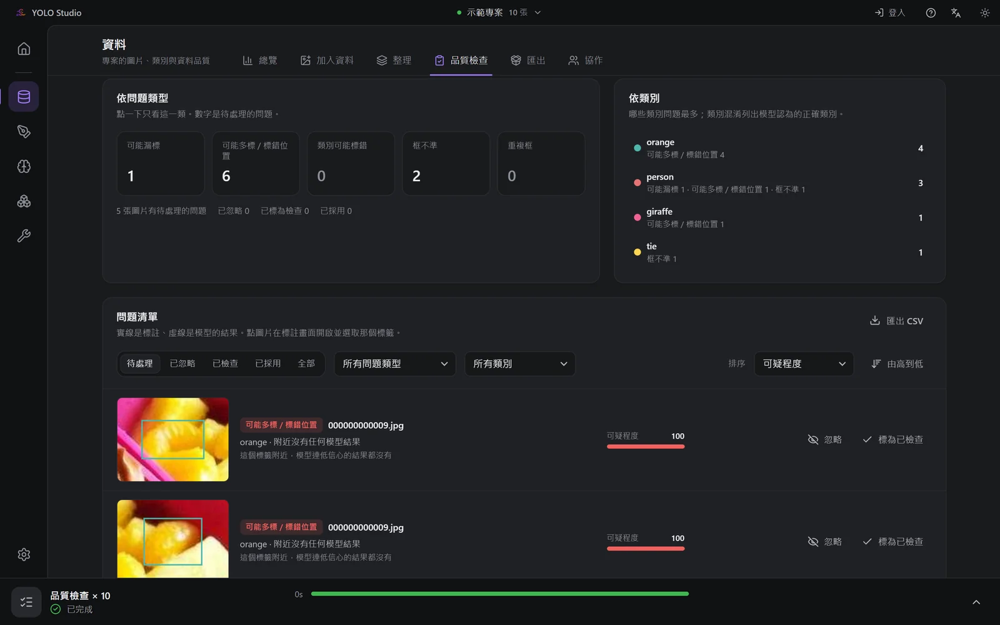
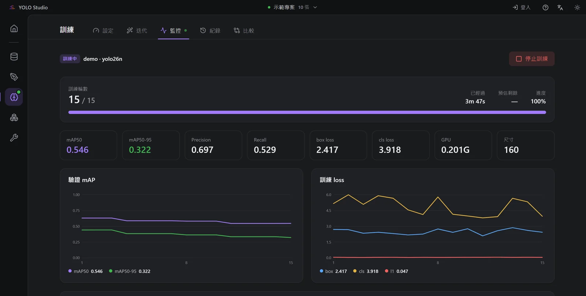
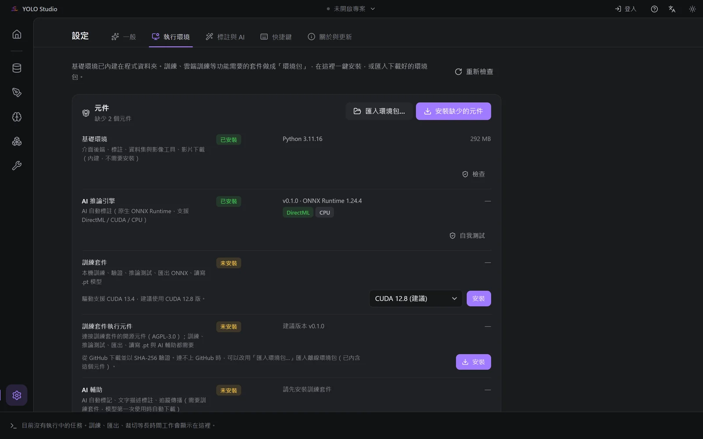

# CVM YOLO Studio

**從資料、標註、訓練到匯出，一個桌面 App 完成整個 YOLO 工作流程。**

繁體中文 · [English](README.en.md)

> [!NOTE]
> 這個 repo 是 **CVM YOLO Studio 的訓練套件元件**（AGPL-3.0 開源）。一般使用者**不需要**直接下載它：
> 在 App 的「設定 → 執行環境」按「安裝」，就會自動下載對應的版本並驗證完整性。
> 想了解這個元件本身，請看[關於這個 repo](#關於這個-repo)。

---

## 為什麼是 CVM YOLO Studio

訓練一個好用的 YOLO 模型，通常要在好幾個工具之間來回：標註軟體、格式轉換腳本、訓練指令、匯出工具……
CVM YOLO Studio 把它們整合成一個流程，介面完整中文化，下載解壓就能用。

## 功能亮點

### ✏️ 標註

| | |
| --- | --- |
| **AI 自動標記** | 點一下物件就產生標籤，精度可選高 / 中 / 低；也可以**匯入自己的 ONNX / PyTorch 模型**，依模型的類別自動對應 |
| **頭身標籤組** | 標身體時自動把頭一起標好，人群裡也不會配錯人；輸出方框或輪廓 |
| **關鍵影格補間** | 兩張影格各標一次，中間每一張自動補框，適合遊戲錄影等連續畫面 |
| **追蹤傳播** | 指定物件後自動一路追到後續影格，結果先預覽再套用 |
| **文字描述標註** | 用一句英文描述就能找出物件，不需要先訓練 |
| **從我的標註學習** | 用已經標好的圖片當範例，立刻改進 AI 自動標記；也可以邊標邊學，在背景越標越準 |
| **低信心優先審核** | 從最沒把握的 AI 結果開始檢查，`Shift+R` 一鍵進入 |
| **多種任務** | 偵測、分割、姿態、旋轉框 |

### 🗂️ 資料

- **15 種標註格式**：YOLO、COCO、Pascal VOC、LabelMe 等，可以直接**就地開啟現有資料集並寫回原格式**
- **品質檢查**：用模型比對現有標籤，依可疑程度列出漏標、多標、類別標錯、框不準、重複框，點一下就跳去修正
- **類別平衡**：各類別數量、不平衡比例，以及每類大約還要補多少張
- **資料集工具**：重複圖片偵測、ROI 裁切、影片抽幀、train / val / test 切分、資料增強

### 🧠 訓練與模型

- **本機 GPU、Google Colab、Kaggle** 三種訓練方式，即時 loss / mAP 曲線
- **一鍵迭代（主動學習）**：訓練 → 自動標註剩下的圖 → 人工審核 → 下一輪，各輪 mAP 一目了然
- **模型紀錄**：每次訓練的資料集指紋、參數、指標都會保存，可以並排比較、標記上線版本
- **自動調參**：用短訓練搜尋學習率、增強等參數，一鍵套用最佳結果
- **匯出**：ONNX 以及多種部署格式，內建原生推論引擎做驗證與批次推論

### 👥 協作 預覽

- 區網內多人同時標註同一個專案：每張圖自動鎖定、即時同步、修訂紀錄、審核流程
- 白名單 + 分享連結，連線加密並驗證身分
- 官方協作伺服器、自架伺服器、遠端直連陸續推出

### 介面與體驗

- **免安裝**：下載解壓、執行一個 exe；訓練環境在「執行環境」頁一鍵安裝
- **自動偵測環境**：已經裝好的 CUDA、cuDNN、PyTorch 會直接沿用；自動判斷要不要用中國大陸鏡像
- **大型專案也流暢**：數萬張圖的專案約 2 秒開啟、0.3 秒存檔
- 繁體中文 / 簡體中文 / English，深色與淺色主題，新手導覽，一鍵匯出診斷資訊

## 截圖

<table>
  <tr>
    <td colspan="2" align="center">
       
      <b>標註</b>：全螢幕編輯器、類別與標籤清單
    </td>
  </tr>
  <tr>
    <td width="50%" align="center">
       
      <b>品質檢查</b>：依可疑程度列出漏標、多標與框不準
    </td>
    <td width="50%" align="center">
       
      <b>訓練</b>：即時 mAP / loss 曲線
    </td>
  </tr>
  <tr>
    <td colspan="2" align="center">
       
      <b>執行環境</b>：在這裡一鍵安裝訓練套件與這個元件
    </td>
  </tr>
</table>

截圖使用示範專案（Ultralytics 範例圖片與 coco8 資料集）。

## 下載

**預覽階段，公開下載即將推出。**

| 方案 | 內容 |
| --- | --- |
| **免費** | 全部標註、資料、訓練、匯出功能，以及進階訓練參數、訓練比較、自動調參、加入協作 |
| **Pro** | 建立共享專案、使用官方協作伺服器 |

使用時需要免費註冊的帳號，並保持網路連線（短暫斷線 30 分鐘內可以繼續使用）。

### 系統需求

- Windows 10 / 11（64 位元）
- 訓練建議使用 NVIDIA 顯示卡；沒有也能標註，並用 GPU（DirectML）或 CPU 推論
- 建議 16 GB 記憶體

## 關於這個 repo

這裡是 CVM YOLO Studio 的**訓練套件元件**，負責把 App 的訓練、驗證、推論與匯出請求交給
[Ultralytics](https://github.com/ultralytics/ultralytics) 執行，再把結果交回 App。

- **自動安裝**：App 在「設定 → 執行環境」下載與自己配對的版本，並以 sha256 驗證。
- **版本配對**：元件與 App 的版本成對發布；內部協定會隨 App 一起變動，不提供獨立使用的說明。
- **發布檔**：每個 [Release](../../releases) 附 `ul_bridge-<版本>.zip` 與 `.sha256`。

## 授權

- **這個 repo**：[GNU AGPL-3.0](LICENSE)。
- **CVM YOLO Studio App**：專有軟體，免費使用；App 本身不內含 Ultralytics，訓練相關功能透過這個元件在獨立行程中執行。
- **第三方元件**：見 [THIRD_PARTY_NOTICES.md](THIRD_PARTY_NOTICES.md)。Ultralytics 採用 AGPL-3.0。

CVM YOLO Studio · Made for people who just want to train a good model.

